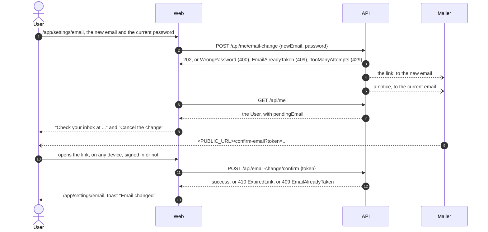
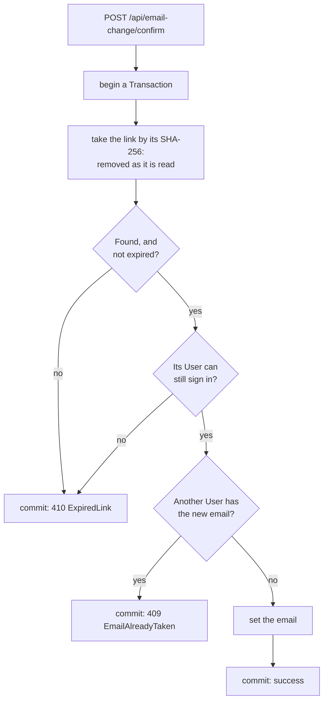

# Email Change

How a signed-in User replaces their email: the new one takes effect once they open a link sent to it. The use case is `EmailChanges` (`apps/server/src/modules/identity/application/email-changes.ts`); the words are those of `GLOSSARY.md`.

## The flow

## Asking

`EmailChanges.request(userId, newEmail, password)`.

- `EMAIL_CHANGES_PER_USER` (5 an hour, in `ServerConfig.attemptLimits`) counts every request, a wrong password included: it bounds the mails sent, and the passwords a stolen Session can try.
- A wrong current password fails with `WrongPassword`. An email a User has, the User's own included, fails with `EmailAlreadyTaken`: a signed-in User already learns that much from sign-up.
- The link is `linkTokenBytes` random bytes in base64url, stored as its SHA-256 with the new email, and lasts `emailChangeLifetime` (24 hours). It replaces the User's earlier one: asking again makes the earlier link useless.
- The notice to the current email masks the new one, and says to reset the password if the User did not ask.

`GET /api/me` answers `pendingEmail`, the new email of a link that has not expired, or `null`. `DELETE /api/me/email-change` removes the link.

## Confirming

`EmailChanges.confirm(token)`, behind no `Authentication`: the token, mailed to the new email, proves the User holds it.

- The email is looked up before it is set: on Postgres, a unique violation would abort the transaction, and the link would stay unspent. Two confirms that race past the lookup still meet `users_email_key`, and the loser fails with `EmailAlreadyTaken`.
- A refused link stays spent: the User asks again.
- The Sessions stay: the password has not changed.

## A link

| `link_tokens` |                                          |
| ------------- | ---------------------------------------- |
| `purpose`     | `email_change`                           |
| `new_email`   | the email the link makes the User's      |
| `expires_at`  | asked + `emailChangeLifetime` (24 hours) |

The rest is that of a Password Reset (`docs/password-reset.md`): one link of each purpose per User, by `UNIQUE (user_id, purpose)`.

## The web app

The settings have an Email section (`features/email-change`), which loads `GET /api/me` on its own, since the Current User of the route carries no pending email. `/confirm-email` lives under `_link`, a layout that redirects no one, so a User signed in or not opens it; it confirms on a click of "Confirm this email", so a scanner that opens the links of a mail confirms nothing.
