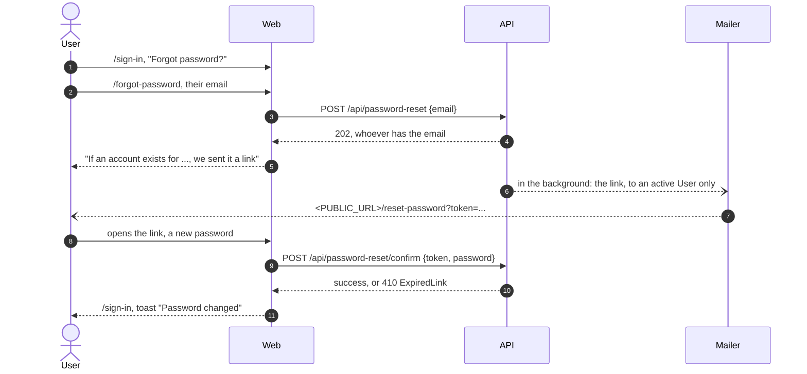
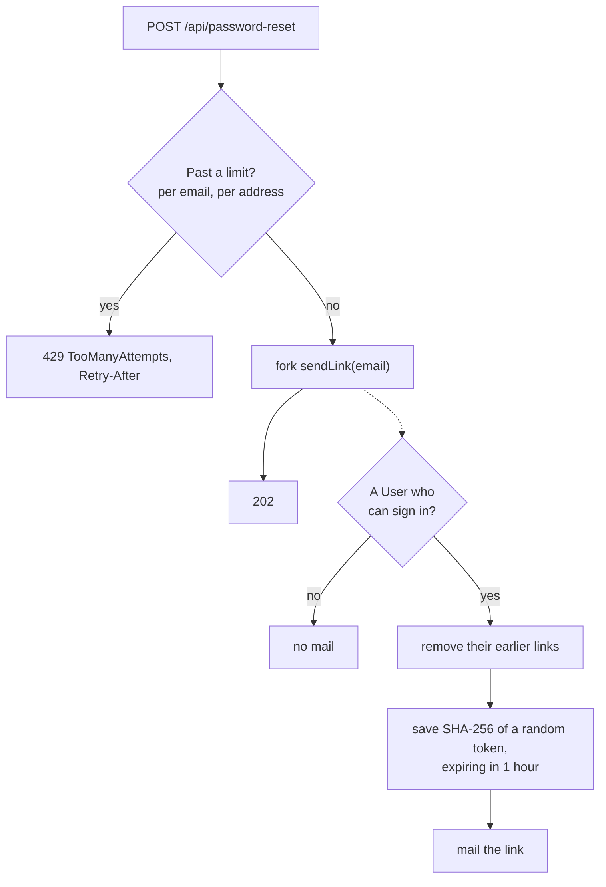
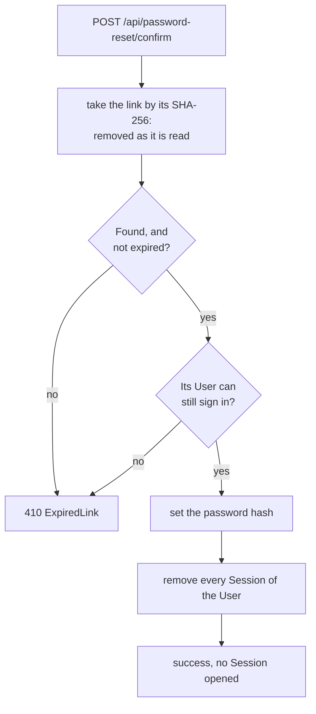
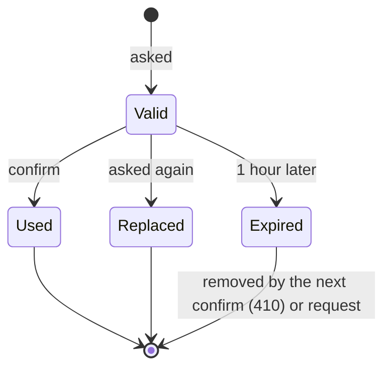
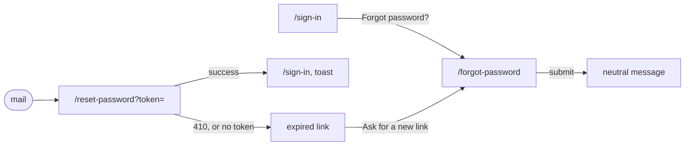

# Password Reset

How a User who forgot their password chooses a new one, through a link sent by email. The use case is `PasswordResets` (`apps/server/src/modules/identity/application/password-resets.ts`); the words are those of `GLOSSARY.md`.

## The flow

## Asking for a link

`PasswordResets.request(email, ip)`. The answer says nothing of whether a User has the email: the same status, in the same time.

- The limits count every request, whoever has the email, so a 429 tells nothing either: `PASSWORD_RESETS_PER_EMAIL` (5 an hour) and `PASSWORD_RESETS_PER_IP` (20 an hour), in `ServerConfig.attemptLimits`.
- `sendLink` runs in a fiber of the server's scope (`Effect.forkIn`), not of the request: a User who gets the mail would otherwise get a slower answer. A failure is logged, the 202 already sent.
- The token is `linkTokenBytes` random bytes in base64url; only its SHA-256 is stored. The link starts from `ServerConfig.publicOrigin`, never from the request.
- The template is imported on the first mail, so the scripts that load the identity module (the seed) need no `.tsx` hook.

## Confirming

`PasswordResets.confirm(token, password)`.

- `take` is one `DELETE ... RETURNING`: two confirms of one link at once, one wins.
- Every Session ends, an intruder's included. The User signs in with the new password.
- A User suspended since they asked is refused as a stranger.

## A link

| `link_tokens` |                                                                   |
| ------------- | ----------------------------------------------------------------- |
| `token_hash`  | SHA-256 of the token, primary key                                 |
| `user_id`     | the User, `ON DELETE CASCADE`                                     |
| `purpose`     | `password_reset`; the table is meant for every link sent by email |
| `expires_at`  | asked + `passwordResetLifetime` (1 hour)                          |

An index on `(user_id, purpose)` serves the removal of a User's earlier links. Nothing sweeps expired links.

## The web app

Both pages are under `_guest`: a signed-in User goes to `/app`. `/reset-password` checks the token on submit only (`features/identity/reset-password-form.tsx`).

## Left open

- The confirm writes are not in one transaction: a crash between them can spend the link and keep the old password, or keep old Sessions.
- Two requests at the same instant may each leave a valid link.
